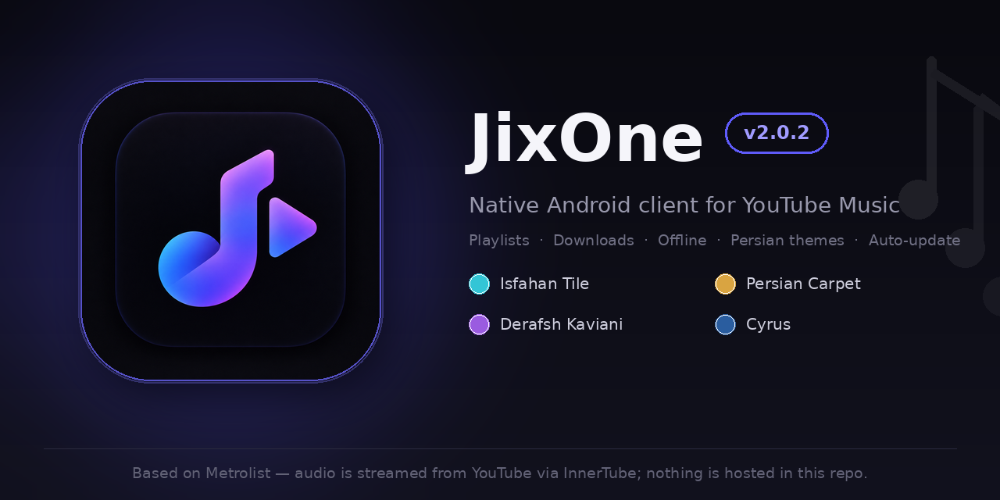

  

**پلیر نیتیو اندروید برای یوتیوب موزیک**
Native Android client for YouTube Music

[⬇ دانلود آخرین نسخه · Download latest](https://github.com/jixa11/JixOne/releases/latest)

## دانلود · Download

همه‌ی فایل‌ها با حجم دقیق و SHA-256 در صفحه‌ی [Releases](https://github.com/jixa11/JixOne/releases/latest):

| فایل | برای |
| --- | --- |
| `JixOne-*-arm64-v8a.apk` | **پیشنهادی** — گوشی‌های جدید (تقریباً ۲۰۱۵ به بعد) |
| `JixOne-*-armeabi-v7a.apk` | گوشی‌های قدیمی ۳۲ بیتی |
| `JixOne-*-x86_64.apk` | شبیه‌ساز اندروید |
| `JixOne-*-universal.apk` | **همه‌ی دستگاه‌ها** — روی هر گوشی‌ای نصب می‌شود |

نصب مستقیم APK · اندروید ۸ به بالا · امضای v1 + v2 + v3 · نصب نشد؟ [عیب‌یابی اینجاست](docs/GUIDE.md#install-troubleshooting--عیب‌یابی-نصب)

- **منبع موسیقی:** کاتالوگ YouTube Music (بدون ساندکلاد و رادیو جوان) — ورود با حساب توصیه می‌شود
- **تم‌ها:** فرش ایرانی، کاشی اصفهان، درفش کاویانی، کوروش + ۸ تم دیگر — پیش‌فرض: فرش ایرانی
- **قابلیت‌ها:** پخش و دانلود آفلاین، پلی‌لیست (و کپی پلی‌لیست)، متن آهنگ، اکولایزر، تایمر خواب، Android Auto، به‌روزرسانی داخل اپ
- بسته‌ی `com.jixone.native` — کنار اپ قدیمی WebView (`com.jixone.app`) نصب می‌شود

📚 **[راهنمای کامل: نصب، عیب‌یابی، سوالات، بیلد](docs/GUIDE.md)** · Full guide: install, troubleshooting, FAQ, building

---

JixOne hosts no media — all audio streams from YouTube. Native app based on [Metrolist](https://github.com/Metrolist/Metrolist) (GPL-3.0); attribution preserved in `native/`. · [Changelog](docs/RELEASE-NOTES.md) · [Issues](https://github.com/jixa11/JixOne/issues)
