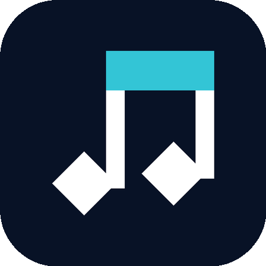

<div align="center">
  

# JixOne

**Native Android client for YouTube Music** · پلیر نیتیو اندروید برای یوتیوب موزیک

[⬇ Download · دانلود](https://github.com/jixa11/JixOne/releases/latest)

</div>

---

## Download & install · دانلود و نصب

| | |
| --- | --- |
| Recommended · پیشنهادی | `JixOne-2.0.2-arm64-v8a.apk` — for phones made after ~2015 (27.3 MB, a bit lighter than universal) |
| Older 32-bit phones | `JixOne-2.0.2-armeabi-v7a.apk` |
| Emulator | `JixOne-2.0.2-x86_64.apk` |
| Universal (every device) | `JixOne-2.0.2.apk` (29.9 MB) — or `JixOne-2.0.2-apk.zip` (survives bad proxies better) |
| Where | [Releases page](https://github.com/jixa11/JixOne/releases/latest) only — exact sizes and SHA-256 checksums are published there for every file |
| Signature | **v1 + v2 + v3** (all schemes), key `CN=JixOne` (valid to 2056) |
| Android | **8.0 (API 26) or newer** · اندروید ۸ به بالا |
| Package | `com.jixone.native` — coexists with the old WebView app (`com.jixone.app`) |

### «App not installed as package appears to be invalid»

The APK on the Releases page is **verified valid** — checked with Google's own `apksigner verify` (signature **Verifies**), `zipalign` and `aapt` all pass, and the signing certificate matches the JixOne key. When a phone still shows this error, the cause is almost always the downloaded copy or the device, in this order:

1. **Incomplete download (most common).** A browser can report “download complete” on a truncated file. Check the size in your file manager — it must match the **exact byte size on the release page**. If it differs, re-download over a stable connection or VPN, ideally with Chrome itself (not a download manager).
2. **Use the zip copy to prove it.** Each release also ships `JixOne-<version>-apk.zip`. Download that instead, extract it, install the APK inside. **If extraction fails, the download was corrupted — definitively.** If it extracts fine but still won't install, the problem is on the device side.
3. **Older test build installed.** If an earlier JixOne *native* test APK happens to be on the device, uninstall it first — different signatures cannot upgrade over each other. (The old WebView JixOne can stay; it is a different package.)
4. **Android below 8.0** cannot install this app.
5. **ROM restrictions.** On Xiaomi/MIUI enable *Install via USB* in Developer options; on Huawei/Honor watch for AppGallery guards.
6. Optional: `sha256sum JixOne-*.apk` must print the SHA-256 published on the release.

### دانلود و نصب (فارسی)

۱. برای گوشی‌های جدید (۲۰۱۵ به بعد) فایل **`JixOne-2.0.2-arm64-v8a.apk`** را از صفحه‌ی [Releases](https://github.com/jixa11/JixOne/releases/latest) دانلود کنید — مخصوص پردازنده‌ی گوشی شماست و کمی سبک‌تر از نسخه‌ی کامل است. برای گوشی‌های قدیمی ۳۲ بیتی نسخه‌ی `armeabi-v7a` و برای همه‌ی دستگاه‌ها نسخه‌ی `JixOne-2.0.2.apk` (universal) موجود است.
۲. **حجم فایل باید دقیقاً با عدد نوشته‌شده در صفحه‌ی Releases یکی باشد** (بایت به بایت). اگر متفاوت بود یعنی دانلود ناقص است — با اینترنت پایدار، VPN و خودِ کروم دوباره بگیرید.
۳. اندروید ۸ به بالا لازم است. اگر نسخه‌ی آزمایشی قدیمی‌تری از اپ نیتیو نصب دارید، اول آن را حذف کنید (اپ قدیمی WebView مشکلی ندارد و جدا است).
۴. شیائومی: گزینه‌ی «Install via USB» در Developer options را فعال کنید. اجازه‌ی «Install unknown apps» هم باید به مرورگر/فایل‌منیجر داده شود.

---

## What's new — 2.0.2: the JixOne look is back

**The Persian artwork themes from the original web app now live in the native app.** The four JixOne themes — Persian Carpet, Isfahan Tile, Derafsh Kaviani and Cyrus — carry their real artwork (the carpet photo, the Isfahan tilework, the banner, the relief) behind the whole app, veiled exactly like before so text keeps full contrast. **Persian Carpet is the default theme again**, the way the web app was. The other web-app themes (Neon Crimson, Neo Tokyo, Synthwave, Classic Spotify, Dubai Sunset, YouTube) are in the theme picker too. Settings → Appearance has a new "Persian artwork background" switch if you ever want the artwork off.

Also in this release, after a user's phone refused a 29 MB universal APK that apksigner proves valid:

- **Per-CPU builds** — `arm64-v8a` (most phones), `armeabi-v7a` (older phones), `x86_64` (emulator), plus the universal build; all report the same version code, so switching between them never looks like a downgrade. The in-app updater automatically picks the right one for the device.
- The APK is signed with **all three signature schemes (v1 + v2 + v3)** — quirky OEM installers accept it more readily (2.0.1).
- Every release also ships a **zip-wrapped copy** and **SHA-256 checksums** for every APK (2.0.1).

JixOne started as a WebView wrapper around a bundled web app. **v2.0.0 replaced that with a fully native app** (Kotlin + Jetpack Compose + Media3/ExoPlayer, based on Metrolist 13.7.0):

| | WebView app (v1.x) | Native app (v2.0+) |
| --- | --- | --- |
| Playback | HTML5 audio in a WebView | Media3/ExoPlayer service — real background playback |
| Downloads | Browser storage (OPFS) inside the app | Real audio files on your storage, survive reinstalls of data |
| Offline | Inside the sandbox only | System-wide, any player can see exported files |
| Lock screen | Basic MediaSession | MediaStyle notification, Bluetooth/headset buttons, Android Auto, Cast |
| Account | Cookie-based session | YouTube Music account sign-in in the app |
| Updates | Manual APK | In-app **check for updates** + changelog |
| Language | English / Persian | Full Persian (RTL) UI + 20+ languages via Metrolist |
| Themes | 12 web themes | The JixOne web themes, ported — Persian artwork + all the rest |

The old web app (v1.5.2) is still in this repository and still works — see the legacy section below.

## Music source — منبع موسیقی

JixOne plays the **YouTube Music catalog**, streamed through YouTube's internal InnerTube API on your own IP — no middleman server, no rehosted audio.

- **Not SoundCloud, not Radio Javan.** Those services are not part of the app and never were — in either the old or the new version.
- Signing in with your YouTube Music account is recommended: anonymous playback calls are bot-gated (`LOGIN_REQUIRED`) on most tracks, and a signed-in session also unlocks licensed songs and albums in search.
- Playback reliability depends on your network/IP — residential IPs and normal VPNs behave best; datacenter IPs are gated hard.

## Screenshots

The native app is brand new — real device screenshots will be added as it is used (feel free to share yours in an issue). Screenshots of the v1.x **web** app are preserved in the legacy section at the bottom.

---

## English

### The native app (v2.0+)

Everything is verified in the shipped code, not aspirational:

- **Full YouTube Music catalog** — search songs, albums, artists and playlists; stream instantly.
- **Account sign-in** — log in with your YouTube Music account inside the app.
- **Complete player** — play/pause, next/previous, shuffle, repeat (off / all / one), drag-and-drop queue.
- **Playlists** — create, rename, delete, add/remove songs, and **copy a playlist** (new in 2.0: duplicates the whole list with all its songs in order — «کپی فهرست پخش» in the ⋯ menu).
- **Downloads & offline** — download songs and entire playlists as real audio files; play them with zero network.
- **Lyrics** (synced), **sleep timer**, **equalizer**, **backup/restore** the library, **M3U** playlist import/export.
- **Android Auto** and **Google Cast** (GMS build), MediaStyle notification, Bluetooth & headset controls.
- **Persian UI** — full `values-fa` translation with RTL layout; the JixOne web themes are ported over, Persian Carpet artwork by default, plus Material You dynamic color.
- **In-app updater** — Settings → About → *Check for updates* reads this repo's releases and opens the new APK when one is available.

### Building the native app

CI does the releases: push a tag like `n2.1.0` and [.github/workflows/native-release.yml](.github/workflows/native-release.yml) builds a signed GMS release APK (key material comes from repo secrets — see [docs/SIGNING.md](docs/SIGNING.md)) and attaches it to the GitHub release. The in-app updater finds it automatically.

Local build (JDK 21):

```bash
cd native
./gradlew assembleGmsDebug     # debug APK
./gradlew assembleGmsRelease   # release APK (project key, debug fallback)
```

Release checklist: bump `versionName`/`versionCode` in `native/app/build.gradle.kts` → commit → tag `n<version>` → push. Done.

### The web app (v1.x — legacy, still here)

The Next.js web app and its WebView APK remain in this repo (`src/`, `android/`). It still installs as a PWA, streams via the same InnerTube approach, and its README knowledge base lives on below. For day-to-day listening, the native app is now the recommended build.

<details>
<summary>Web app details (v1.5.2)</summary>

| Home | Now playing | Settings | Mobile |
| --- | --- | --- | --- |
|  |  |  |  |

<details>
<summary>Web app Persian themes — فرش ایرانی، کاشی اصفهان، درفش کاویانی، کوروش</summary>

| فرش ایرانی · Persian Carpet | کاشی اصفهان · Isfahan Tile |
| --- | --- |
|  |  |

| درفش کاویانی · Kaviani Banner | کوروش هخامنشی · Cyrus the Great |
| --- | --- |
|  |  |

</details>

- **Ad-free engine with fallback** — streams are extracted on-device (ANDROID_VR → ANDROID_MUSIC → TVHTML5 → WEB_REMIX client chain, byte-range-probed before playback); regional blocks are detected *before* playback starts and hand off to the official player.
- **Sign-in matters** — YouTube bot-gates anonymous player calls (`LOGIN_REQUIRED`). In the Android app: Settings → Account. On the web: paste your `music.youtube.com` cookie in Settings, or set `YTM_COOKIE` for self-hosting.
- **Run it** — `npm install && npm run dev`, or `npm run build && npm start`. Build the WebView APK with `./build-apk.sh`.
- **Tech stack** — Next.js 16, TypeScript, Tailwind CSS 4, Zustand, OPFS offline storage, Kotlin WebView shell.

</details>

### Disclaimer

JixOne is a client for publicly available YouTube content and hosts no media itself — all audio is streamed from YouTube. Use it in accordance with YouTube's Terms of Service and your local copyright laws. The Persian theme artwork is third-party stock imagery — check its licence before redistributing. The native app is based on [Metrolist](https://github.com/Metrolist/Metrolist); its license and attribution are preserved in `native/`.

---

## فارسی

### اپ نیتیو (نسخه ۲٫۰ به بعد)

جیکس‌وان از یک WebView دور رابط وب شروع شد؛ **نسخه ۲٫۰٫۰ یک اپ کاملاً نیتیو** است (Kotlin + Jetpack Compose + Media3/ExoPlayer بر پایه‌ی Metrolist 13.7.0). همه‌ی موارد زیر در کد نسخه‌ی منتشرشده بررسی و تأیید شده است:

- **دسترسی کامل به کاتالوگ YouTube Music** — جستجوی آهنگ، آلبوم، خواننده و پلی‌لیست؛ پخش فوری.
- **ورود با حساب یوتیوب موزیک** — داخل خود اپ؛ محدودیت ربات هم برداشته می‌شود و کاتالوگ دارای لایسنس هم در جستجو باز می‌شود.
- **پلیر کامل** — پخش/توقف، بعدی/قبلی، شافل، تکرار (خاموش/همه/یکی)، مدیریت صف با درگ‌اند‌دراپ.
- **پلی‌لیست‌ها** — ساخت، تغییر نام، حذف، افزودن/حذف آهنگ و **کپی پلی‌لیست** (تازه در نسخه ۲٫۰: از منوی ⋯ هر پلی‌لیست، یک نسخه‌ی کامل با همه‌ی آهنگ‌ها و همان ترتیب ساخته می‌شود — «کپی فهرست پخش»).
- **دانلود و پخش آفلاین** — دانلود آهنگ و کل پلی‌لیست به‌صورت فایل صوتی واقعی روی حافظه؛ پخش بدون اینترنت.
- **متن آهنگ (همگام)**، **تایمر خواب**، **اکولایزر**، **پشتیبان‌گیری/بازیابی کتابخانه**، درون‌ریزی/برون‌بری **M3U**.
- **Android Auto** و **Google Cast** (بیلد GMS)، نوتیفیکیشن MediaStyle، کنترل با بلوتوث و هدفون.
- **رابط فارسی** — ترجمه‌ی کامل `values-fa` با چیدمان راست‌به‌چپ؛ تم‌های وب‌اپ جیکس‌وان (با پیش‌فرض فرش ایرانی و پس‌زمینه‌ی هنری) به‌علاوه‌ی Material You.
- **بررسی به‌روزرسانی داخل اپ** — تنظیمات ← درباره ← «بررسی به‌روزرسانی» ریلیزهای همین ریپو را می‌خواند و دانلود نسخه‌ی جدید را باز می‌کند.

### منبع موسیقی

جیکس‌وان کاتالوگ **YouTube Music** را از طریق API داخلی InnerTube یوتیوب و با IP خودتان پخش می‌کند — بدون سرور واسط و بدون میزبانی فایل.

- **ساندکلاد و رادیو جوان جزو اپ نیستند** — نه در نسخه‌ی قبلی و نه در نسخه‌ی جدید.
- ورود با حساب توصیه می‌شود: درخواست‌های پخش ناشناس روی بیشتر آهنگ‌ها محدود می‌شوند (`LOGIN_REQUIRED`).
- پایداری پخش به شبکه‌ی شما بستگی دارد — اینترنت خانگی و VPNهای عادی بهترین نتیجه را می‌دهند.

### بیلد و انتشار نسخه‌ی نیتیو

انتشار با CI انجام می‌شود: یک تگ مثل `n2.1.0` بزنید تا [native-release.yml](.github/workflows/native-release.yml) APK امضاشده‌ی release بسازد و به ریلیز گیت‌هاب بچسباند؛ به‌روزرسانی داخل اپ هم خودکار آن را پیدا می‌کند (مطابق [docs/SIGNING.md](docs/SIGNING.md)، کلید امضا در Secretهای ریپو است).

بیلد محلی (JDK 21):

```bash
cd native
./gradlew assembleGmsDebug
./gradlew assembleGmsRelease
```

چک‌لیست انتشار: `versionName`/`versionCode` در `native/app/build.gradle.kts` را بالا ببرید ← کامیت ← تگ `n<version>` ← پوش. تمام.

### اپ وب (نسخه ۱٫x — قدیمی، ولی همین‌جا هست)

اپ وب (Next.js) و APK وب‌ویویی آن همچنان در همین ریپو هستند (`src/` و `android/`) و مثل قبل کار می‌کنند؛ برای گوش‌دادن روزمره اما نسخه‌ی نیتیو توصیه می‌شود.

### سلب مسئولیت

جیکس‌وان فقط یک کلاینت برای محتوای عمومی یوتیوب است و هیچ فایل صوتی میزبانی نمی‌کند — همه‌ی پخش مستقیماً از یوتیوب انجام می‌شود. استفاده‌ی شما تابع قوانین یوتیوب و قوانین حق نشر محل زندگی‌تان است. اپ نیتیو بر پایه‌ی [Metrolist](https://github.com/Metrolist/Metrolist) ساخته شده و مجوز و اشاره‌ی آن در `native/` حفظ شده است.
