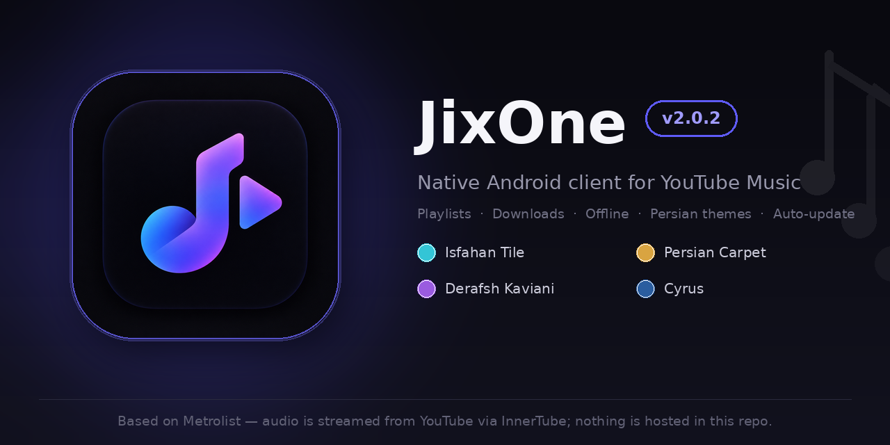
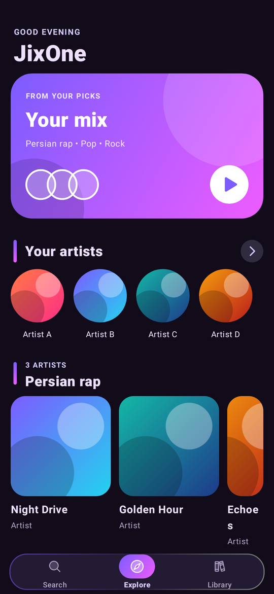
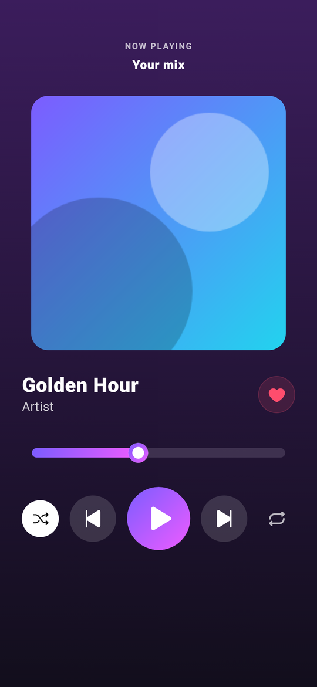
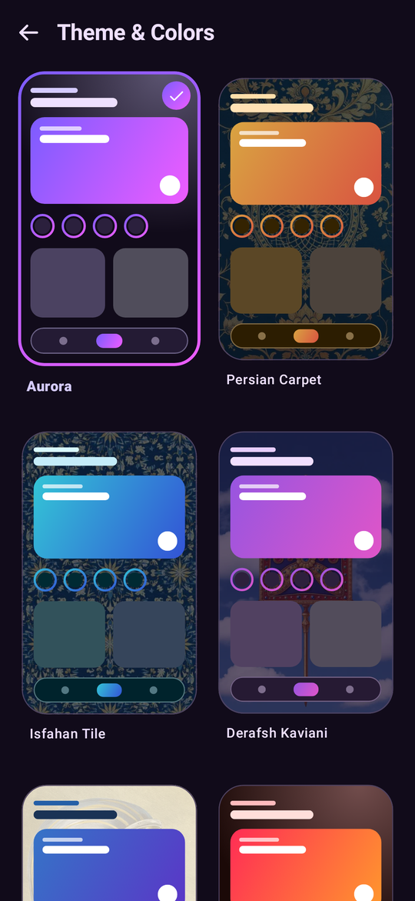
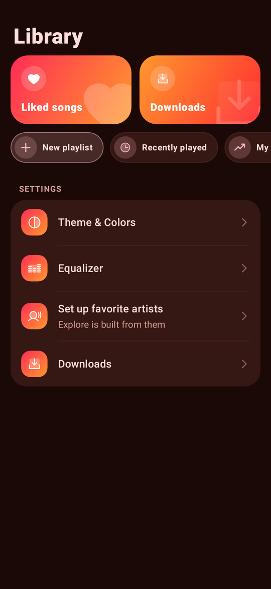

  

# JixOne

**پلیر موسیقی اندروید برای YouTube Music — رایگان، بدون تبلیغ، با ظاهر خودش**
A free, ad-free Android music player for the YouTube Music catalog

[⬇ دانلود آخرین نسخه · Download](https://github.com/jixa11/JixOne/releases/latest) · [💻 نسخه دسکتاپ · Desktop](https://github.com/jixa11/jixone-desktop/releases/latest)

اکسپلورِ شخصی · پلیر · ۱۲ تم · کتابخانه

## چرا JixOne

- **اکسپلورِ خودتان:** آرتیست‌هایتان را انتخاب کنید؛ قفسه‌ها بر اساس سبک ساخته می‌شوند، با تازه‌های همان آرتیست‌ها، ترندها و پادکست‌ها.
- **پخش بدون دردسر:** پخش در پس‌زمینه، دانلود برای آفلاین، صف، متن آهنگ، تایمر خواب و اکولایزر.
- **ژست‌های سریع:** آهنگ را به راست بکشید تا بعدی پخش شود؛ در پلی‌لیست خودتان به چپ بکشید تا حذف شود.
- **۱۲ تم:** از Aurora تا فرش ایرانی، کاشی اصفهان، درفش کاویانی و کوروش — هر کدام با پیش‌نمایش.
- **ویجت و خودرو:** ویجت صفحه‌ی اصلی با کاور آهنگ، و Android Auto.
- **حساب اختیاری:** بدون ورود هم کار می‌کند؛ با ورود، لایک‌ها و پلی‌لیست‌های YouTube Music همگام می‌شوند.
- **روی کامپیوتر هم:** [JixOne Desktop](https://github.com/jixa11/jixone-desktop) برای ویندوز، مک و لینوکس — بدون سرور، مستقیم از YouTube Music.

## نصب

از صفحه‌ی [Releases](https://github.com/jixa11/JixOne/releases/latest) یکی را بردارید:

| فایل | برای |
| --- | --- |
| `JixOne-*-arm64-v8a.apk` | **پیشنهادی** — بیشتر گوشی‌ها |
| `JixOne-*-universal.apk` | همه‌ی دستگاه‌ها |
| `JixOne-*-armeabi-v7a.apk` | گوشی‌های قدیمی ۳۲ بیتی |
| `JixOne-*-x86_64.apk` | شبیه‌ساز |

اندروید ۸ به بالا. به‌روزرسانی‌های بعدی از داخل خود برنامه می‌آید. نصب نشد؟ [راهنما و عیب‌یابی](docs/GUIDE.md).

## English

JixOne plays the YouTube Music catalog with its own interface: a personal Explore built from the artists you pick (genre shelves, new releases, trending, podcasts), offline downloads, lyrics, queue, sleep timer and equalizer, swipe gestures on songs, twelve themes, a home-screen widget and Android Auto. A desktop version for Windows, macOS and Linux lives at [jixone-desktop](https://github.com/jixa11/jixone-desktop). Signing in is optional. Install the APK from [Releases](https://github.com/jixa11/JixOne/releases/latest); Android 8 or newer.

---

JixOne hosts no media; all audio streams from YouTube. The app in `native/` is a fork of [Metrolist](https://github.com/Metrolist/Metrolist) (GPL-3.0) and keeps its attribution. Icons: [Phosphor](https://phosphoricons.com) (MIT). · [Changelog](docs/RELEASE-NOTES.md) · [Issues](https://github.com/jixa11/JixOne/issues)
