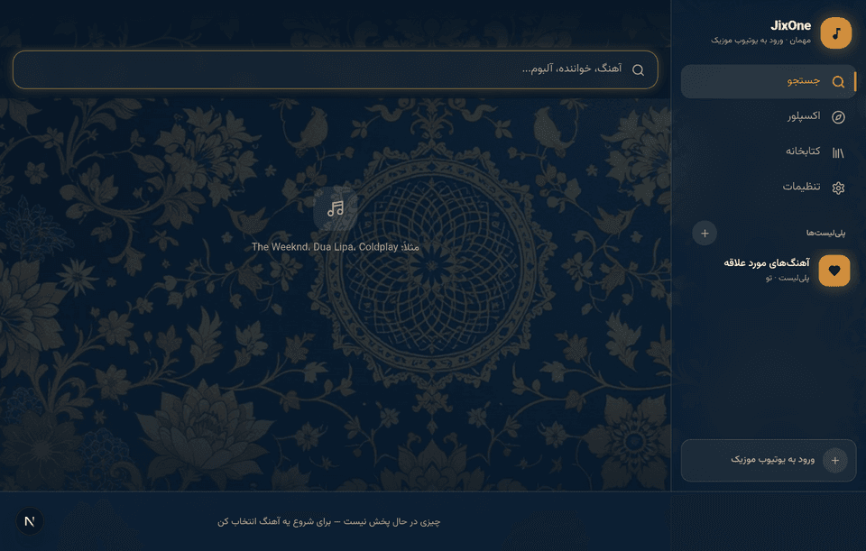
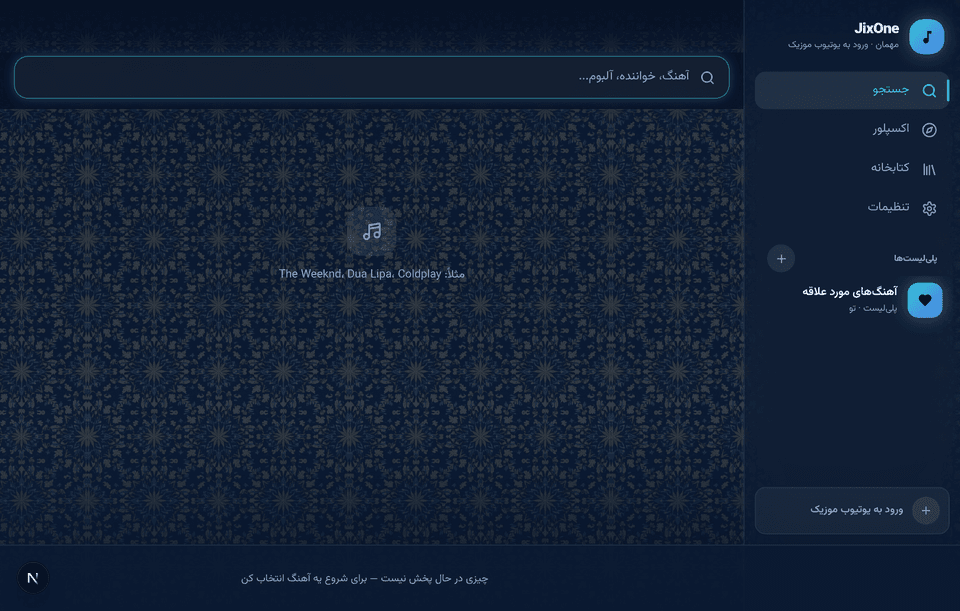
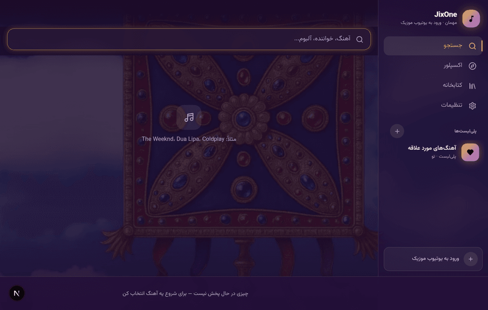
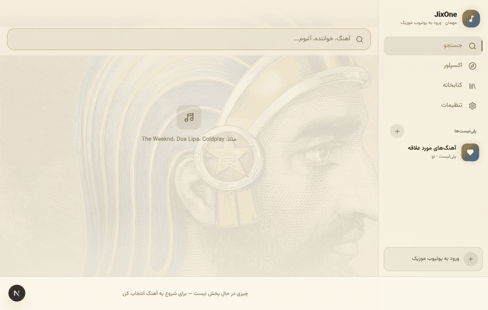
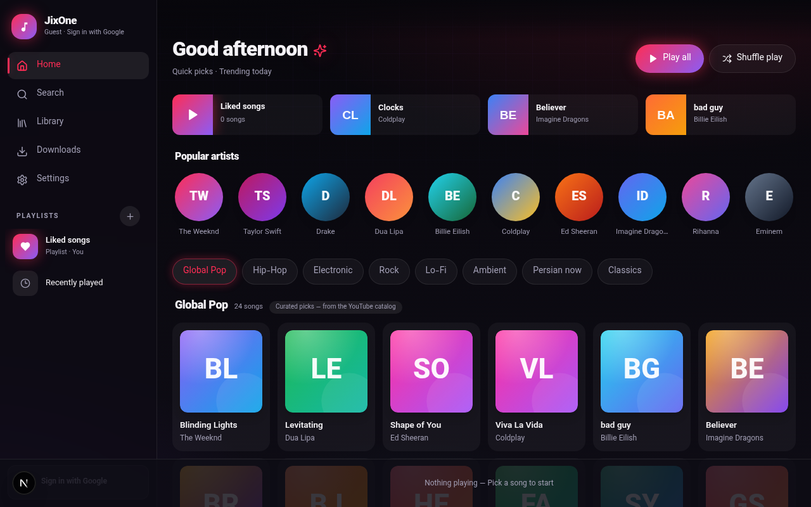
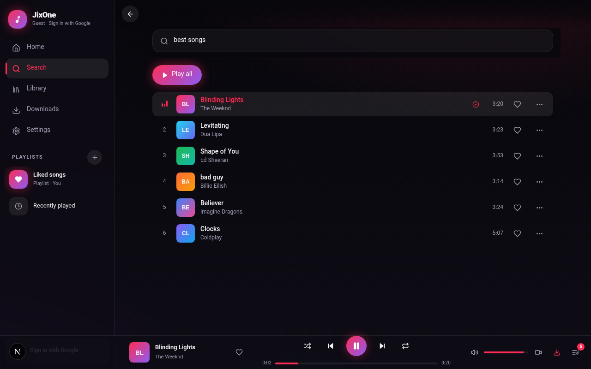
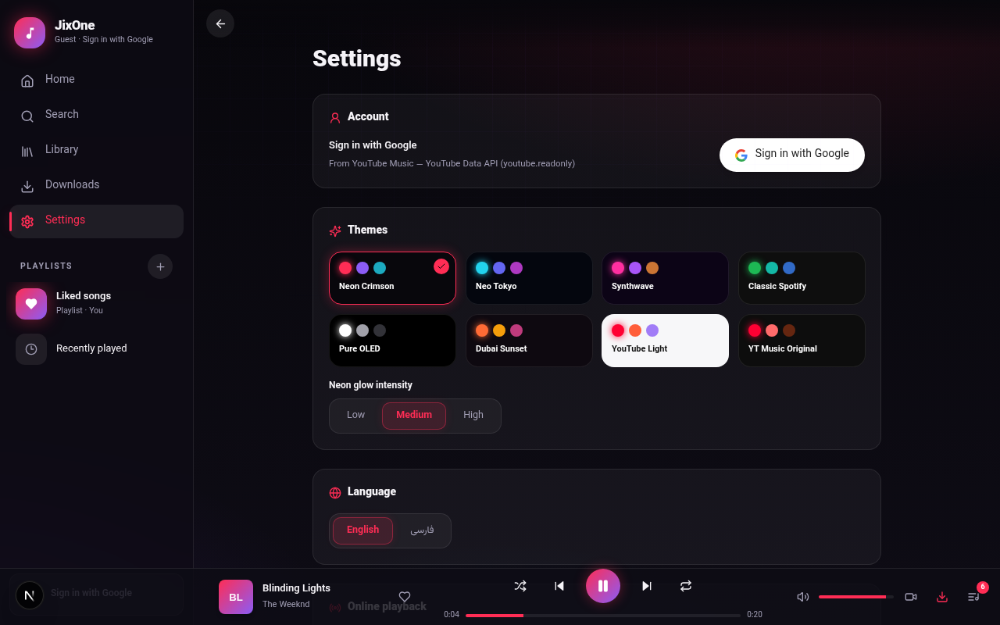
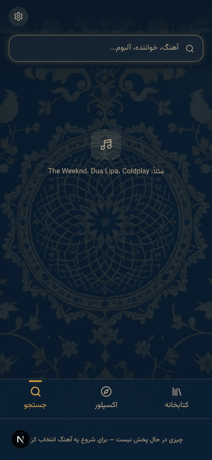

# JixOne — راهنمای کامل · Full Guide

همه‌چیز درباره‌ی نصب، به‌روزرسانی و استفاده از جیکس‌وان.
Everything about installing, updating and using JixOne.

**[← بازگشت به صفحه اصلی · Back to the README](../README.md)**

## فهرست · Contents

- [Download & install · دانلود و نصب](#download--install--دانلود-و-نصب)
- [Install troubleshooting · عیب‌یابی نصب](#install-troubleshooting--عیب-یابی-نصب)
- [What's new · تازه‌ها](#whats-new--تازهها)
- [Music source · منبع موسیقی](#music-source--منبع-موسیقی)
- [Features · قابلیت‌ها](#features--قابلیت-ها)
- [Themes · تم‌ها](#themes--تمها)
- [WebView vs Native · مقایسه](#webview-vs-native--مقایسه)
- [Building & releases · بیلد و انتشار](#building--releases--بیلد-و-انتشار)
- [Web app (legacy) · اپ وب قدیمی](#web-app-legacy--اپ-وب-قدیمی)
- [Disclaimer · سلب مسئولیت](#disclaimer--سلب-مسئولیت)

---

## Download & install · دانلود و نصب

Get the APK from the [Releases page](https://github.com/jixa11/JixOne/releases/latest) — every file's exact size and SHA-256 checksum is published there.

| File | For |
| --- | --- |
| `JixOne-<version>-arm64-v8a.apk` | **Recommended** — phones made after ~2015 |
| `JixOne-<version>-armeabi-v7a.apk` | older 32-bit phones |
| `JixOne-<version>-x86_64.apk` | Android emulators |
| `JixOne-<version>-universal.apk` | every device — works on any CPU |
| `JixOne-<version>-apk.zip` | zip-wrapped universal APK — survives bad proxies better |

Requirements: **Android 8.0 (API 26) or newer**. The APK is signed with all three signature schemes (**v1 + v2 + v3**), key `CN=JixOne` (valid to 2056). Package name is `com.jixone.native`, so it coexists with the old WebView app (`com.jixone.app`).

### فارسی

۱. از صفحه‌ی [Releases](https://github.com/jixa11/JixOne/releases/latest) فایل مناسب گوشی‌تان را دانلود کنید — برای بیشتر گوشی‌ها `arm64-v8a`؛ اگر مطمئن نیستید، نسخه‌ی `universal` روی همه‌ی دستگاه‌ها نصب می‌شود.
۲. **حجم فایل دانلودی باید دقیقاً با عدد نوشته‌شده در صفحه‌ی Releases یکی باشد** (بایت به بایت). اگر متفاوت بود یعنی دانلود ناقص است — با اینترنت پایدار، VPN و خودِ کروم دوباره بگیرید.
۳. اندروید ۸ به بالا لازم است. اگر نسخه‌ی آزمایشی قدیمی‌تری از اپ نیتیو نصب دارید، اول آن را حذف کنید (اپ قدیمی WebView مشکلی ندارد و جدا است).
۴. شیائومی: گزینه‌ی «Install via USB» در Developer options را فعال کنید. اجازه‌ی «Install unknown apps» هم باید به مرورگر/فایل‌منیجر داده شود.

---

## Install troubleshooting · عیب‌یابی نصب

### «App not installed as package appears to be invalid»

The APK on the Releases page is **verified valid** — checked with Google's own `apksigner verify` (signature **Verifies**), `zipalign` and `aapt` all pass, and the signing certificate matches the JixOne key. When a phone still shows this error, the cause is almost always the downloaded copy or the device, in this order:

1. **Incomplete download (most common).** A browser can report "download complete" on a truncated file. Check the size in your file manager — it must match the **exact byte size on the release page**. If it differs, re-download over a stable connection or VPN, ideally with Chrome itself (not a download manager).
2. **Use the zip copy to prove it.** Each release also ships `JixOne-<version>-apk.zip`. Download that instead, extract it, install the APK inside. **If extraction fails, the download was corrupted — definitively.** If it extracts fine but still won't install, the problem is on the device side.
3. **Older test build installed.** If an earlier JixOne *native* test APK happens to be on the device, uninstall it first — different signatures cannot upgrade over each other. (The old WebView JixOne can stay; it is a different package.)
4. **Android below 8.0** cannot install this app.
5. **ROM restrictions.** On Xiaomi/MIUI enable *Install via USB* in Developer options; on Huawei/Honor watch for AppGallery guards.
6. Optional: `sha256sum JixOne-*.apk` must print the SHA-256 published on the release.

---

## What's new · تازه‌ها

### 4.0.0 — the web app's own skeleton

Navigation rebuilt to match the web app: 3 bottom tabs (Search · Explore · Library, no Home), settings in the top-corner gear, the Lucide icon set everywhere, web quick-cards in Library, and an About page that shows only JixOne branding (open-source credits live in the "Open-source licenses" dialog).

### 3.0.0 — the web app's soul, the native app's engine

**The two JixOnes are now one.** This release takes the look you loved from the old web app and puts it on top of the working native engine, front-end only — the player backend is untouched.

- **The web's ambient mesh background** — three soft theme-colored glows in the screen corners over a vertical gradient, on **every** screen and for **every** theme (the Persian four carry the exact colors from the web's `globals.css`; the rest derive them from their color scheme).
- **Root-cause fix: "it's still a Metrolist copy"** — the main scaffold was painting an opaque layer over the whole background, so the Persian artwork and its veil were never actually visible. Now the themed ground (mesh + artwork + veil) really shows behind the entire app, for the first time.
- **Full-screen player = the web's NowPlaying** (default) — the current cover, blown up and blurred, is the player's ground (`.np-bg` of the web app); real blur on Android 12+, a softened cover below.
- **Mini player = per-track color gradient** (default) — colors are pulled from the playing song's cover, like the web bar.
- **Web-style typography** — bolder headings app-wide; body text untouched for readability (incl. Persian).
- **Glass navigation bar** with an accent indicator pill, and a translucent top bar.

### 2.0.2 — the JixOne look is back

**The Persian artwork themes from the original web app now live in the native app.** The four JixOne themes — Persian Carpet, Isfahan Tile, Derafsh Kaviani and Cyrus — carry their real artwork (the carpet photo, the Isfahan tilework, the banner, the relief) behind the whole app, veiled exactly like before so text keeps full contrast. **Persian Carpet is the default theme again**, the way the web app was. The other web-app themes (Neon Crimson, Neo Tokyo, Synthwave, Classic Spotify, Dubai Sunset, YouTube) are in the theme picker too. Settings → Appearance has a "Persian artwork background" switch if you ever want the artwork off.

- **Per-CPU builds** — `arm64-v8a` (most phones), `armeabi-v7a` (older phones), `x86_64` (emulator), plus the universal build; all report the same version code, so switching between them never looks like a downgrade. The in-app updater automatically picks the right one for the device.
- The APK is signed with **all three signature schemes (v1 + v2 + v3)** — quirky OEM installers accept it more readily (2.0.1).
- Every release also ships a **zip-wrapped copy** and **SHA-256 checksums** for every APK (2.0.1).
- The About screen is JixOne's own (upstream Metrolist is credited separately inside).

### 2.0.0 — the native rewrite

JixOne started as a WebView wrapper around a bundled web app. **v2.0.0 replaced that with a fully native app** (Kotlin + Jetpack Compose + Media3/ExoPlayer, based on Metrolist 13.7.0). See the [comparison table](#webview-vs-native--مقایسه) below.

---

## Music source · منبع موسیقی

JixOne plays the **YouTube Music catalog**, streamed through YouTube's internal InnerTube API on your own IP — no middleman server, no rehosted audio.

- **Not SoundCloud, not Radio Javan.** Those services are not part of the app and never were — in either the old or the new version.
- Signing in with your YouTube Music account is recommended: anonymous playback calls are bot-gated (`LOGIN_REQUIRED`) on most tracks, and a signed-in session also unlocks licensed songs and albums in search.
- Playback reliability depends on your network/IP — residential IPs and normal VPNs behave best; datacenter IPs are gated hard.

جیکس‌وان کاتالوگ **YouTube Music** را از طریق API داخلی InnerTube یوتیوب و با IP خودتان پخش می‌کند — بدون سرور واسط و بدون میزبانی فایل. ورود با حساب توصیه می‌شود: درخواست‌های پخش ناشناس روی بیشتر آهنگ‌ها محدود می‌شوند (`LOGIN_REQUIRED`) و با حساب واردشده کاتالوگ دارای لایسنس هم در جستجو باز می‌شود.

---

## Features · قابلیت‌ها

Everything is verified in the shipped code, not aspirational:

- **Full YouTube Music catalog** — search songs, albums, artists and playlists; stream instantly.
- **Account sign-in** — log in with your YouTube Music account inside the app.
- **Complete player** — play/pause, next/previous, shuffle, repeat (off / all / one), drag-and-drop queue.
- **Playlists** — create, rename, delete, add/remove songs, and **copy a playlist** (duplicates the whole list with all its songs in order — «کپی فهرست پخش» in the ⋯ menu).
- **Downloads & offline** — download songs and entire playlists as real audio files; play them with zero network.
- **Lyrics** (synced), **sleep timer**, **equalizer**, **backup/restore** the library, **M3U** playlist import/export.
- **Android Auto** and **Google Cast** (GMS build), MediaStyle notification, Bluetooth & headset controls.
- **Persian UI** — full `values-fa` translation with RTL layout; the JixOne web themes are ported over, Persian Carpet artwork by default, plus Material You dynamic color.
- **In-app updater** — Settings → About → *Check for updates* reads this repo's releases and opens the new APK when one is available.

---

## Themes · تم‌ها

Settings → Appearance. The four JixOne Persian themes carry their real artwork behind the whole app (switchable via "Persian artwork background"):

| فرش ایرانی · Persian Carpet | کاشی اصفهان · Isfahan Tile |
| --- | --- |
|  |  |

| درفش کاویانی · Kaviani Banner | کوروش هخامنشی · Cyrus the Great |
| --- | --- |
|  |  |

*(Screenshots above are from the v1.x web app with the same artwork the native app now uses.)*

Plus: Neon Crimson, Neo Tokyo, Synthwave, Classic Spotify, Dubai Sunset, YouTube — and Material You dynamic color.

---

## WebView vs Native · مقایسه

| | WebView app (v1.x) | Native app (v2.0+) |
| --- | --- | --- |
| Playback | HTML5 audio in a WebView | Media3/ExoPlayer service — real background playback |
| Downloads | Browser storage (OPFS) inside the app | Real audio files on your storage, survive reinstalls of data |
| Offline | Inside the sandbox only | System-wide, any player can see exported files |
| Lock screen | Basic MediaSession | MediaStyle notification, Bluetooth/headset buttons, Android Auto, Cast |
| Account | Cookie-based session | YouTube Music account sign-in in the app |
| Updates | Manual APK | In-app **check for updates** + changelog |
| Language | English / Persian | Full Persian (RTL) UI + 20+ languages via Metrolist |
| Themes | 12 web themes | The JixOne web themes, ported — Persian artwork + all the rest |

---

## Building & releases · بیلد و انتشار

CI does the releases: push a tag like `n2.1.0` and [.github/workflows/native-release.yml](../.github/workflows/native-release.yml) builds signed GMS release APKs — per-CPU (`arm64-v8a`, `armeabi-v7a`, `x86_64`) plus `universal` — and attaches them to the GitHub release. The in-app updater finds the right one automatically.

Local build (JDK 21):

```bash
cd native
./gradlew assembleGmsDebug     # debug APK
./gradlew assembleGmsRelease   # release APK (project key, debug fallback)
```

Release checklist: bump `versionName`/`versionCode` in `native/app/build.gradle.kts` → commit → tag `n<version>` → push. Done. (Signing key material lives in repo secrets — see [SIGNING.md](SIGNING.md).)

---

## Web app (legacy) · اپ وب قدیمی

The Next.js web app and its WebView APK remain in this repo (`src/`, `android/`). It still installs as a PWA, streams via the same InnerTube approach. For day-to-day listening, the native app is the recommended build.

<details>
<summary>Web app details (v1.5.2)</summary>

| Home | Now playing | Settings | Mobile |
| --- | --- | --- | --- |
|  |  |  |  |

- **Ad-free engine with fallback** — streams are extracted on-device (ANDROID_VR → ANDROID_MUSIC → TVHTML5 → WEB_REMIX client chain, byte-range-probed before playback); regional blocks are detected *before* playback starts and hand off to the official player.
- **Sign-in matters** — YouTube bot-gates anonymous player calls (`LOGIN_REQUIRED`). On the web: paste your `music.youtube.com` cookie in Settings, or set `YTM_COOKIE` for self-hosting.
- **Run it** — `npm install && npm run dev`, or `npm run build && npm start`. Build the WebView APK with `./build-apk.sh`.
- **Tech stack** — Next.js 16, TypeScript, Tailwind CSS 4, Zustand, OPFS offline storage, Kotlin WebView shell.

</details>

---

## Disclaimer · سلب مسئولیت

JixOne is a client for publicly available YouTube content and hosts no media itself — all audio is streamed from YouTube. Use it in accordance with YouTube's Terms of Service and your local copyright laws. The Persian theme artwork is third-party stock imagery — check its licence before redistributing. The native app is based on [Metrolist](https://github.com/Metrolist/Metrolist); its license and attribution are preserved in `native/`.

جیکس‌وان فقط یک کلاینت برای محتوای عمومی یوتیوب است و هیچ فایل صوتی میزبانی نمی‌کند — همه‌ی پخش مستقیماً از یوتیوب انجام می‌شود. استفاده‌ی شما تابع قوانین یوتیوب و قوانین حق نشر محل زندگی‌تان است. اپ نیتیو بر پایه‌ی Metrolist ساخته شده و مجوز و اشاره‌ی آن در `native/` حفظ شده است.
